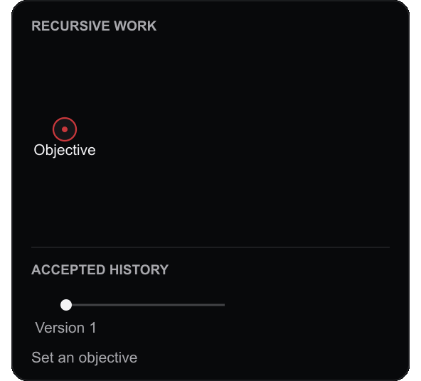
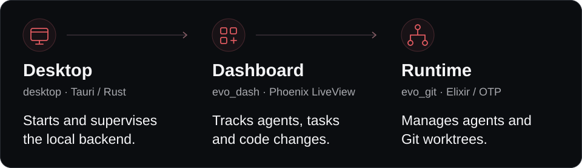

<h1 align="center">
  <picture>
    <source media="(prefers-color-scheme: dark)" srcset="apps/evo_dash/priv/static/images/logo-alt.svg">
    
  </picture> EvoX Genesis
</h1>

<p align="center"><strong>One objective in. A software world unfolds.</strong></p>

<p align="center">
  Open-source AI agents for software development.<br>
  Describe the software you want. Genesis coordinates agents to build, validate, and evolve it.
</p>

<p align="center">
  <a href="https://genesis.evox.group/#download"><strong>Download Genesis</strong></a> ·
  <a href="https://genesis.evox.group/">Website</a> ·
  <a href="https://genesis.evox.group/getting-started/">Docs</a> ·
  <a href="https://genesis.evox.group/evidence/">Evidence</a> ·
  <a href="https://arxiv.org/abs/2608.10450">Paper</a>
</p>

https://github.com/user-attachments/assets/d7f3d520-e39f-45cd-a525-77e5e8d00a75

<p align="center">
  <strong>Eighty seconds. One objective.</strong><br>
  <a href="https://genesis.evox.group/#film">Watch the film on the website →</a>
</p>

## See development unfold

- **Set an objective.** Start a new project or bring an existing repository. Describe the outcome and constraints; Genesis decomposes the work as needed.
- **Follow the work.** Watch the recursive agent tree, inspect tasks and model usage, and review diffs in the desktop dashboard.
- **Keep developing.** Continue from accepted results, refine the objective, or move execution to a server while keeping your local dashboard.

[New projects](https://genesis.evox.group/usage/new-project/) · [Existing repositories](https://genesis.evox.group/usage/existing-repo/) · [Remote development](https://genesis.evox.group/usage/remote-ssh/)

<!-- evidence:start -->

## Built with Genesis

Selected software worlds developed with Genesis.

| Project | What emerged | Reported result |
| :-- | :-- | :-- |
| [C Compiler](https://genesis.evox.group/evidence/c-compiler) | A Rust-based C compiler built from scratch | 220 / 220 c-testsuite |
| [MESA](https://genesis.evox.group/evidence/mesa) | 13 Fortran modules redeveloped in Rust | 1,052 / 1,052 (0 failures) Rust test suite |
| [tbench-wasm](https://genesis.evox.group/evidence/tbench-wasm) | A software WebGL renderer in TypeScript | 2,017 / 2,019 (99.90%) Khronos WebGL CTS |

Latest evidence: [EvoX Compiler](https://genesis.evox.group/evidence/evoxc) · 2026-10-28

[Explore all evidence →](https://genesis.evox.group/evidence/)

<!-- evidence:end -->

## The world persists. Agents do not.

<picture>
  <source media="(prefers-reduced-motion: reduce)" srcset="docs/images/readme/recursive-world-inline.png">
  
</picture>

**An objective becomes local work.** Managers break down the goal, delegate tasks, and review the results. Executors implement and validate candidate changes in isolated Git worktrees.

**Each task has a place.** An accepted software version records what has been built; a repository path defines context, responsibility, and scope. `CONTEXT.md` files make these local contracts explicit.

**Accepted results carry forward.** The hierarchy unfolds as development proceeds. Agents finish their episodes; software versions and project history remain as the starting point for subsequent work.

[Explore the architecture →](https://genesis.evox.group/developer/architecture/high-level-design/)

<br clear="all">

## Start with an objective

### Desktop app

**[Download Genesis →](https://genesis.evox.group/#download)** for macOS, Linux, or Windows. The website selects the installer for your platform; all published builds are available in [GitHub Releases](https://github.com/EMI-Group/genesis/releases/latest).

1. Install and open Genesis.
2. Choose a model provider and model, and configure your API credentials.
3. Create a project or select an existing repository, then describe what you want to build.

For example:

> Add rate limiting to this API. Preserve existing endpoint behavior, make the limits configurable, and add tests for requests above and below the limit.

[Installation guide](https://genesis.evox.group/getting-started/installation/) · [Model configuration](https://genesis.evox.group/config/)

Want to understand or operate Genesis? Open **Assistant** (`/help`) — **Genesis Assistant** understands the running system and can act on it: it reads Genesis source and inspects runtime state without approval, drives tasks and scheduler/configuration changes only after you approve the exact action, and answers in your language. See the [Genesis Assistant guide](docs/genesis-assistant.md) for capabilities and safety boundaries.

### Headless server

Run the dashboard and agent runtime on Linux (x86_64 or ARM64) or macOS (Apple Silicon):

```bash
curl -LsSf https://genesis.evox.group/dl/install.sh | sh
genesis start
genesis status
```

Open **http://127.0.0.1:9999** and configure your model provider in **Settings**. The server listens on localhost by default and has no built-in authentication; use an SSH tunnel for remote access.

[Server installation and service management →](https://genesis.evox.group/getting-started/installation/headless-server/)

### Remote development

Keep the desktop dashboard on your laptop and run agents on a server through an encrypted SSH tunnel. Tasks continue when the connection drops, and you can manage multiple remote targets from one dashboard.

[Set up remote development →](https://genesis.evox.group/usage/remote-ssh/)

## Built for long-running development

<picture>
  <source media="(max-width: 600px)" srcset="docs/images/readme/architecture-mobile.svg">
  
</picture>

Git records software versions; SQLite stores runtime and task data. Candidate changes run in isolated worktrees, with platform-specific execution controls described in the [sandbox documentation](https://genesis.evox.group/features/sandbox/).

### Run from source

Use **Elixir 1.20.4 and Erlang/OTP 29** to match the repository's CI environment, with Git installed.

```bash
git clone https://github.com/EMI-Group/genesis.git
cd genesis
mix deps.get
mix assets.setup
mix phx.server
```

Open **http://localhost:4100**.

[Build the desktop app or use the Nix dev shell →](https://genesis.evox.group/developer/build/)

<details>
<summary>Benchmark your machine's I/O</summary>

Agents create worktrees, read and write files, and commit changes. Measure this workload on your filesystem:

```bash
mix bench.io
mix bench.io --dir /mnt/nvme --iterations 10 --files 500 --writes 50
mix bench.io --json > bench.json
```

The benchmark creates and removes its own throwaway repository without starting the Genesis runtime. Results cover worktree creation, reads and writes, Git operations, and worktree reclamation.

</details>

## Research, community, and contributions

Genesis is developed by the [EvoX Group](https://evox.group) at The Hong Kong Polytechnic University. For research and collaboration, [get in touch](https://genesis.evox.group/#contact). For bugs and feature requests, [open an issue](https://github.com/EMI-Group/genesis/issues).

Contributions are welcome. See [CONTRIBUTING.md](CONTRIBUTING.md) for development guidelines and the contributor license agreement, which the CLA assistant handles on your first pull request.

Genesis grew out of [EvoGit](https://github.com/BillHuang2001/evogit) and follows the broader [EvoX](https://github.com/EMI-Group/evox) research lineage.

Released under the [GNU Affero General Public License v3.0](LICENSE).
